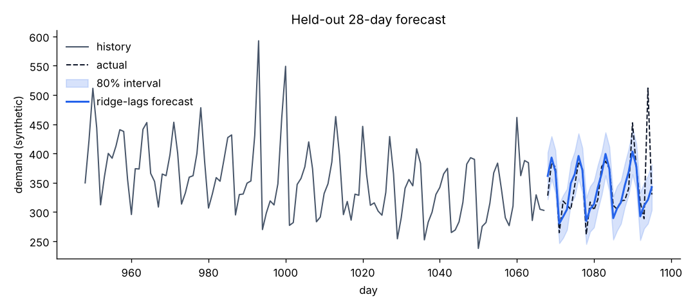
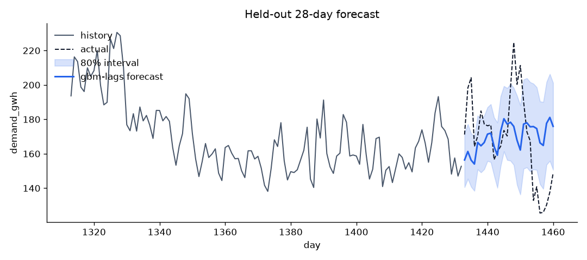
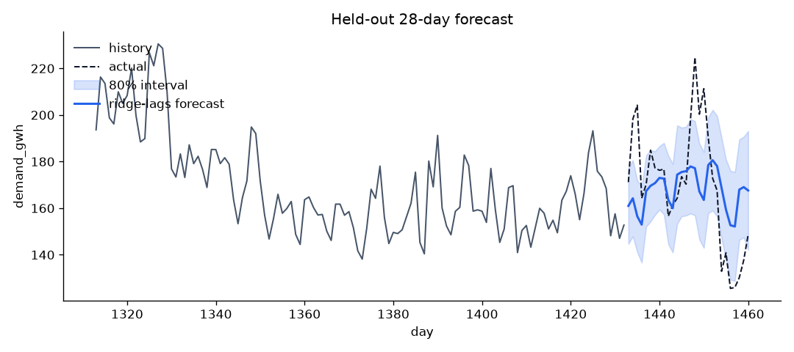

# forecast-lab

[](https://github.com/Agampal007/forecast-lab/actions/workflows/ci.yml)
[](https://codespaces.new/Agampal007/forecast-lab)

Time-series forecasting done carefully: seven models behind one interface, a **rolling-origin backtest** that never trains on the future, **prediction intervals** whose real coverage is measured, and a small **FastAPI service**.

Results are reported on two series: a synthetic one with known structure (trend, weekly and yearly seasonality, promotions, noise), and four years of **real NSW electricity demand from AEMO**. Bring your own data with `--csv`.

## Run it from GitHub

- **In the browser:** click **Open in GitHub Codespaces**. The container installs everything and forwards port 8000. Run `forecastlab serve` and open the forwarded port at `/docs` for an interactive API page.
- **From the Actions tab:** open **Run a backtest**, press **Run workflow**, choose a horizon and interval level, and read the leaderboard in the job summary (the forecast plot is attached as an artifact).
- **On every push:** CI runs the tests on Python 3.10-3.13, starts the API and requests a real forecast, builds the Docker image and checks `/health` inside it, and publishes the backtest leaderboard to the job summary.

## Run it locally

```bash
pip install -e ".[dev,plots]"
forecastlab backtest --level 0.8 --plot results/forecast.png   # about 20 seconds
forecastlab forecast --model holt-winters --horizon 14          # CSV to stdout
forecastlab serve                                               # API on :8000, docs at /docs
pytest
```

With Docker: `docker build -t forecast-lab . && docker run -p 8000:8000 forecast-lab`.

Your own data: `forecastlab backtest --csv sales.csv --column units --season-length 7` (a CSV with a header row; observations must be regularly spaced, oldest first).

## Results on the synthetic series

1,096 daily points. Thirteen folds: train on the first 730 days (then 758, 786, ...), forecast the next 28, refit, repeat, so no fold sees its own test window. Intervals are 80% nominal. Lower is better for every error column.

| Model | MAE | RMSE | sMAPE % | MASE | Coverage of 80% interval | Mean width |
| --- | --- | --- | --- | --- | --- | --- |
| ridge-lags | 28.23 | 42.76 | 7.39 | 1.03 | 0.805 | 81.4 |
| gbm-lags | 28.74 | 42.93 | 7.54 | 1.05 | 0.832 | 83.8 |
| holt-winters | 29.98 | 45.21 | 7.81 | 1.10 | 0.797 | 86.7 |
| seasonal-naive | 41.55 | 62.23 | 10.50 | 1.52 | 0.780 | 107.8 |
| moving-average | 51.79 | 65.81 | 13.72 | 1.89 | 0.802 | 157.7 |
| drift | 60.70 | 79.45 | 16.55 | 2.23 | 0.835 | 228.2 |
| naive | 61.74 | 80.66 | 16.87 | 2.27 | 0.846 | 230.7 |



What the numbers support:

- **Modelling the seasonality matters most.** The three seasonal models cut MAE by about 30% against seasonal-naive (28.2 against 41.6) and by more than half against naive. Ridge beat seasonal-naive in 12 of 13 folds.
- **The top three are close.** Ridge and gradient boosting differ by 0.5 MAE with a paired standard error of 1.6 (ridge won 7 of 13 folds), so they are indistinguishable here. Ridge beat Holt-Winters by 1.7 ± 0.9 (9 of 13 folds): suggestive, not conclusive.
- **Close to the floor.** The series is generated, so the true structure is known. Forecasting with the exact trend and seasonality, without the random promotions and noise, gives an MAE of 24.3 over the same period. The best model's 28.2 is within about 4 of what a forecaster that knew the true structure would get (an estimate, not a strict bound).
- **The intervals are roughly calibrated.** Nominal 80% intervals covered 78-85% of held-out points. Intervals that look right on paper are common; measuring their coverage is the check.
- **MASE near 1 is not a weak result.** MASE divides by the in-sample error of a 7-day seasonal-naive forecast, which is inflated by noise in both of the values being differenced. Compare models by their MASE ranking, not by distance from 1.

## Results on real data: NSW electricity demand

1,461 days of total NSW operational electricity demand (2022-2025, in GWh per day), built from
AEMO's 5-minute price and demand files (source and attribution in [`datasets/`](datasets/README.md)).
Twenty-six folds: train on the first 731 days (2022-2023), forecast the next 28, move forward 28
days, refit, repeat. Same models, settings and 80% intervals as above. These numbers come from the
CI run (Ubuntu, Python 3.12); gradient boosting shifts slightly with platform and scikit-learn
version.

```bash
forecastlab backtest --csv datasets/aemo-nsw-daily.csv --initial 731 --level 0.8
python scripts/compare_models.py gbm-lags seasonal-naive --csv datasets/aemo-nsw-daily.csv --initial 731
```

| Model | MAE (GWh) | RMSE | sMAPE % | MASE | Coverage of 80% interval | Mean width |
| --- | --- | --- | --- | --- | --- | --- |
| gbm-lags | 12.14 | 14.76 | 6.80 | 1.05 | 0.779 | 41.8 |
| ridge-lags | 12.56 | 15.50 | 7.08 | 1.08 | 0.801 | 42.8 |
| holt-winters | 14.75 | 17.61 | 8.32 | 1.27 | 0.777 | 48.7 |
| moving-average | 15.74 | 18.91 | 8.85 | 1.36 | 0.784 | 52.2 |
| seasonal-naive | 16.16 | 19.54 | 9.10 | 1.39 | 0.772 | 51.8 |
| naive | 16.65 | 19.74 | 9.31 | 1.44 | 0.772 | 54.8 |
| drift | 16.83 | 19.95 | 9.40 | 1.45 | 0.772 | 55.3 |



What changes on real data:

- **The lag models still win, but by less.** Gradient boosting cuts MAE by 25% against
  seasonal-naive (12.1 against 16.2 GWh, a paired difference of 4.0 ± 0.9, better in 23 of 26
  folds), compared with about 30% on the synthetic series.
- **Ridge and gradient boosting are still indistinguishable.** They differ by 0.41 GWh with a
  paired standard error of 0.64 (14 folds to 12). Ridge beats Holt-Winters more clearly than on
  synthetic data: 2.2 ± 0.8 GWh, 19 of 26 folds.
- **The weekly cycle matters less than the weather.** Seasonal-naive is barely better than naive
  (16.2 against 16.7), whereas on the synthetic series it halved the error. Real demand swings with
  heat and cold over days, which no model here sees.
- **The intervals stay calibrated.** 80% intervals covered 77-80% of held-out days for every
  model, with no retuning.
- **Holidays are the visible failure.** The plot ends with the 2025 Christmas period. Demand falls
  from about 170 GWh just before Christmas to 125-141 GWh from 25 to 29 December, while the
  forecast stays near 175, well outside its interval. The models know the day of the week but not
  the calendar.

### Adding holiday features

`--holidays NSW` gives the lag models two known-in-advance flags: NSW public holidays (from the
[`holidays`](https://pypi.org/project/holidays/) package) and a year-end break from 24 December to
2 January. Each model sees the flags for the day it predicts and for the same weekday a week
earlier, so it can also discount a weekly lag that fell on a holiday. The flags were fixed by
convention before testing, not tuned on this data. Same 26 folds as above; numbers from CI.

```bash
pip install -e ".[calendar]"
forecastlab backtest --csv datasets/aemo-nsw-daily.csv --initial 731 --level 0.8 --holidays NSW
python scripts/holiday_effect.py --csv datasets/aemo-nsw-daily.csv --initial 731 --region NSW
```

| Model | Holiday features | MAE, all days | MAE, 33 flagged days | MAE, other days |
| --- | --- | --- | --- | --- |
| ridge-lags | no | 12.56 | 26.81 | 11.88 |
| ridge-lags | **yes** | **11.91** | **20.85** | **11.49** |
| gbm-lags | no | 12.14 | 24.15 | 11.57 |
| gbm-lags | yes | 12.04 | 20.70 | 11.63 |



- **Ridge improves clearly.** Overall MAE falls by 0.64 GWh (paired standard error 0.22, better in
  19 of 26 folds), and ridge with holidays is now the best model on this series. Error on flagged
  days falls by 22%.
- **Ordinary days improve too.** Ridge's error on unflagged days drops from 11.88 to 11.49 GWh
  because the lagged-holiday flag stops a holiday from dragging down the next week's forecast.
- **Gradient boosting gains only on the flagged days.** Their error falls by 14%, but the overall
  change (-0.11 ± 0.26) is within noise. With two years of training data it sees only about 40
  flagged days, few for trees to learn a split from.
- **Holidays are still the hardest days.** Flagged-day error is still almost twice that of other
  days. Over Christmas 2025 the forecast now dips to about 152 GWh, against 125-141 actual and 175
  without the flags. The 80% interval stays calibrated (0.805 for ridge).

## How it works

- **Models** (`models.py`): naive, seasonal-naive, drift, moving average, damped additive Holt-Winters (parameters fitted by L-BFGS on one-step squared error), and two recursive regressors, `ridge-lags` and `gbm-lags`. The regressors use 10 lags and Fourier terms for the weekly cycle (and the yearly cycle once there are two years of data). Lags and targets are measured relative to the mean of the previous season, which removes the level so that gradient boosting copes with a trending series.
- **Backtest** (`backtest.py`): `origins()` builds fold boundaries; a test asserts the model is fitted on exactly the first `origin` points of each fold and never on the test window.
- **Intervals** (`intervals.py`): for a forecast of horizon `h`, refit at up to six earlier origins using only earlier data, collect absolute errors by horizon step, pool each step with its three neighbours on both sides, and take the conservative `ceil((n + 1) * level)`-th smallest. Intervals are symmetric around the point forecast. When the series is too short to calibrate, the API returns the forecast with `lower` and `upper` as `null` and a note.
- **API** (`api.py`): `GET /health`, `GET /models`, `POST /forecast`, `POST /backtest`. Requests are validated (finite values, length, horizon, interval level, known model) and errors come back as 422 with a reason that does not echo the input.

```bash
curl -s localhost:8000/forecast -H 'content-type: application/json' \
  -d '{"values": [112, 118, 132, 129, 121, 135, 148, 148, 136, 119, 104, 118, 115, 126, 141, 135, 125, 149, 170, 170, 158, 133, 114, 140],
       "season_length": 12, "horizon": 6, "model": "seasonal-naive", "level": 0.8}'
```

## Limitations

- **One synthetic series and one real one.** The NSW results show that rankings and margins do change on real data. Neither uses weather, the main driver of electricity demand; the NSW backtests can add holiday flags, which help but leave holidays as the hardest days.
- **Regular spacing only.** Seasonal position is the index modulo `season_length`. Missing days or irregular timestamps must be filled in first, and no calendar (holidays, month lengths) is used.
- **Intervals assume the future errors resemble recent errors.** They are symmetric and widen with the horizon only through the empirical errors; they can be too narrow after a regime change. Coverage here is an average over 13 folds, not a guarantee for any single forecast.
- **Recursive forecasts compound errors** at long horizons; there is no direct multi-horizon model.
- **No hyperparameter search.** Ridge and boosting settings are fixed, not tuned.
- **The API is a demo.** There is no authentication, rate limiting or request-size limit beyond 5,000 points and a 365-step horizon, and each request refits models from scratch.

## Layout

```
src/forecastlab/
  data.py       synthetic demand generator, CSV loader
  aemo.py       AEMO 5- and 30-minute files -> daily GWh
  calendar.py   public-holiday and year-end flags (optional holidays package)
  models.py     seven forecasters, registry
  metrics.py    MAE, RMSE, sMAPE, MASE, interval coverage
  intervals.py  rolling-origin calibration of prediction intervals
  backtest.py   rolling-origin evaluation and leaderboard
  api.py        FastAPI service
  cli.py        forecastlab backtest | forecast | serve | models
  plots.py      forecast plot (optional matplotlib)
datasets/       NSW daily demand from AEMO (with attribution)
scripts/        AEMO download, paired model comparison, holiday-feature effect
tests/          51 tests: models, leakage, metrics, interval coverage, AEMO parsing, holidays, API, CLI
```

## License

MIT
