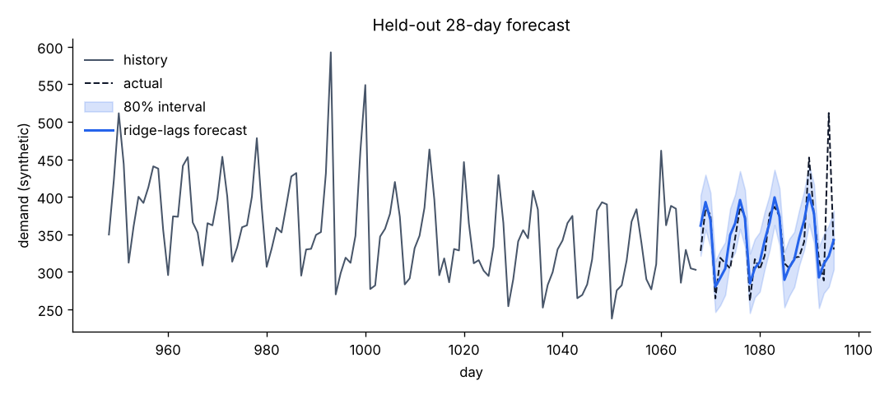

# forecast-lab

[](https://github.com/Agampal007/forecast-lab/actions/workflows/ci.yml)
[](https://codespaces.new/Agampal007/forecast-lab)

Time-series forecasting done carefully: seven models behind one interface, a **rolling-origin backtest** that never trains on the future, **prediction intervals** whose real coverage is measured, and a small **FastAPI service**.

The built-in series is synthetic (known trend, weekly and yearly seasonality, promotions, noise), so the results show how the methods behave, not how they would do on a real business. Bring your own data with `--csv`.

## Run it from GitHub

- **In the browser:** click **Open in GitHub Codespaces**. The container installs everything and forwards port 8000. Run `forecastlab serve` and open the forwarded port at `/docs` for an interactive API page.
- **From the Actions tab:** open **Run a backtest**, press **Run workflow**, choose a horizon and interval level, and read the leaderboard in the job summary (the forecast plot is attached as an artifact).
- **On every push:** CI runs the tests on Python 3.10-3.13, starts the API and requests a real forecast, builds the Docker image and checks `/health` inside it, and publishes the backtest leaderboard to the job summary.

## Run it locally

```bash
pip install -e ".[dev,plots]"
forecastlab backtest --level 0.8 --plot results/forecast.png   # about 20 seconds
forecastlab forecast --model holt-winters --horizon 14          # CSV to stdout
forecastlab serve                                               # API on :8000, docs at /docs
pytest
```

With Docker: `docker build -t forecast-lab . && docker run -p 8000:8000 forecast-lab`.

Your own data: `forecastlab backtest --csv sales.csv --column units --season-length 7` (a CSV with a header row; observations must be regularly spaced, oldest first).

## Results on the synthetic series

1,096 daily points. Thirteen folds: train on the first 730 days (then 758, 786, ...), forecast the next 28, refit, repeat, so no fold sees its own test window. Intervals are 80% nominal. Lower is better for every error column.

| Model | MAE | RMSE | sMAPE % | MASE | Coverage of 80% interval | Mean width |
| --- | --- | --- | --- | --- | --- | --- |
| ridge-lags | 28.23 | 42.76 | 7.39 | 1.03 | 0.805 | 81.4 |
| gbm-lags | 28.74 | 42.93 | 7.54 | 1.05 | 0.832 | 83.8 |
| holt-winters | 29.98 | 45.21 | 7.81 | 1.10 | 0.797 | 86.7 |
| seasonal-naive | 41.55 | 62.23 | 10.50 | 1.52 | 0.780 | 107.8 |
| moving-average | 51.79 | 65.81 | 13.72 | 1.89 | 0.802 | 157.7 |
| drift | 60.70 | 79.45 | 16.55 | 2.23 | 0.835 | 228.2 |
| naive | 61.74 | 80.66 | 16.87 | 2.27 | 0.846 | 230.7 |



What the numbers support:

- **Modelling the seasonality matters most.** The three seasonal models cut MAE by about 30% against seasonal-naive (28.2 against 41.6) and by more than half against naive. Ridge beat seasonal-naive in 12 of 13 folds.
- **The top three are close.** Ridge and gradient boosting differ by 0.5 MAE with a paired standard error of 1.6 (ridge won 7 of 13 folds), so they are indistinguishable here. Ridge beat Holt-Winters by 1.7 ± 0.9 (9 of 13 folds): suggestive, not conclusive.
- **Close to the floor.** The series is generated, so the true structure is known. Forecasting with the exact trend and seasonality, without the random promotions and noise, gives an MAE of 24.3 over the same period. The best model's 28.2 is within about 4 of what a forecaster that knew the true structure would get (an estimate, not a strict bound).
- **The intervals are roughly calibrated.** Nominal 80% intervals covered 78-85% of held-out points. Intervals that look right on paper are common; measuring their coverage is the check.
- **MASE near 1 is not a weak result.** MASE divides by the in-sample error of a 7-day seasonal-naive forecast, which is inflated by noise in both of the values being differenced. Compare models by their MASE ranking, not by distance from 1.

## How it works

- **Models** (`models.py`): naive, seasonal-naive, drift, moving average, damped additive Holt-Winters (parameters fitted by L-BFGS on one-step squared error), and two recursive regressors, `ridge-lags` and `gbm-lags`. The regressors use 10 lags and Fourier terms for the weekly cycle (and the yearly cycle once there are two years of data). Lags and targets are measured relative to the mean of the previous season, which removes the level so that gradient boosting copes with a trending series.
- **Backtest** (`backtest.py`): `origins()` builds fold boundaries; a test asserts the model is fitted on exactly the first `origin` points of each fold and never on the test window.
- **Intervals** (`intervals.py`): for a forecast of horizon `h`, refit at up to six earlier origins using only earlier data, collect absolute errors by horizon step, pool each step with its three neighbours on both sides, and take the conservative `ceil((n + 1) * level)`-th smallest. Intervals are symmetric around the point forecast. When the series is too short to calibrate, the API returns the forecast with `lower` and `upper` as `null` and a note.
- **API** (`api.py`): `GET /health`, `GET /models`, `POST /forecast`, `POST /backtest`. Requests are validated (finite values, length, horizon, interval level, known model) and errors come back as 422 with a reason that does not echo the input.

```bash
curl -s localhost:8000/forecast -H 'content-type: application/json' \
  -d '{"values": [112, 118, 132, 129, 121, 135, 148, 148, 136, 119, 104, 118, 115, 126, 141, 135, 125, 149, 170, 170, 158, 133, 114, 140],
       "season_length": 12, "horizon": 6, "model": "seasonal-naive", "level": 0.8}'
```

## Limitations

- **Synthetic data, one series, one random seed.** Model rankings can change on real demand data, which has holidays, outages and structural breaks that this generator lacks.
- **Regular spacing only.** Seasonal position is the index modulo `season_length`. Missing days or irregular timestamps must be filled in first, and no calendar (holidays, month lengths) is used.
- **Intervals assume the future errors resemble recent errors.** They are symmetric and widen with the horizon only through the empirical errors; they can be too narrow after a regime change. Coverage here is an average over 13 folds, not a guarantee for any single forecast.
- **Recursive forecasts compound errors** at long horizons; there is no direct multi-horizon model.
- **No hyperparameter search.** Ridge and boosting settings are fixed, not tuned.
- **The API is a demo.** There is no authentication, rate limiting or request-size limit beyond 5,000 points and a 365-step horizon, and each request refits models from scratch.

## Layout

```
src/forecastlab/
  data.py       synthetic demand generator, CSV loader
  models.py     seven forecasters, registry
  metrics.py    MAE, RMSE, sMAPE, MASE, interval coverage
  intervals.py  rolling-origin calibration of prediction intervals
  backtest.py   rolling-origin evaluation and leaderboard
  api.py        FastAPI service
  cli.py        forecastlab backtest | forecast | serve | models
  plots.py      forecast plot (optional matplotlib)
tests/          34 tests: models, leakage, metrics, interval coverage, API, CLI
```

## License

MIT
